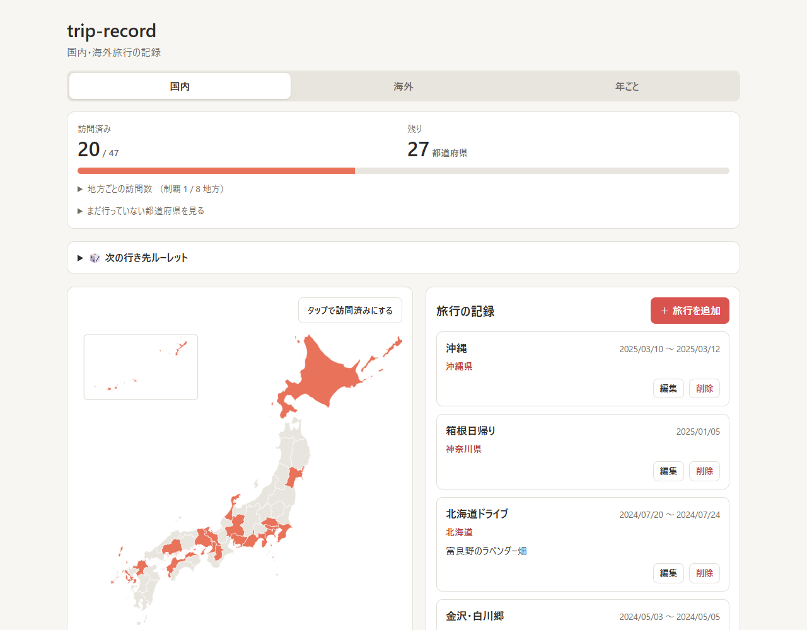
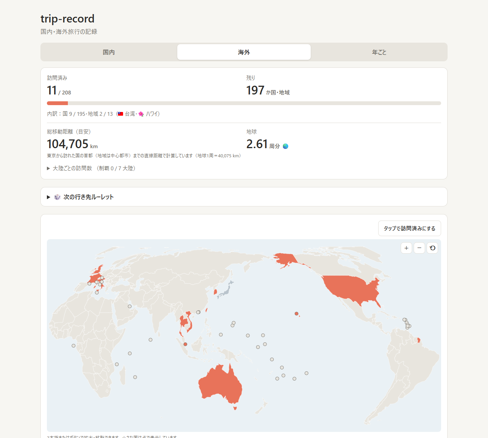
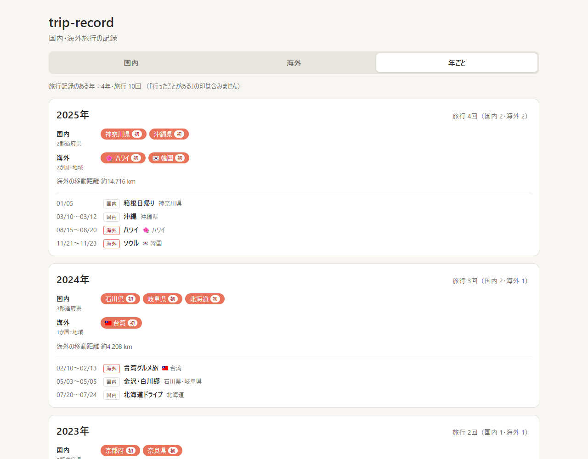
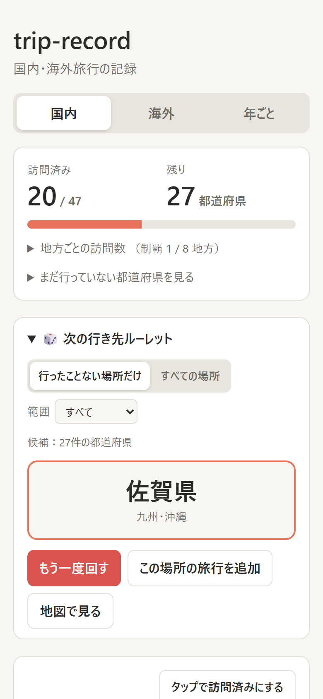

# trip-record

国内・海外旅行の記録アプリです。
行った都道府県・国を地図に塗っていき、全国制覇・世界制覇までの残りの数が分かります。
画面上部の「国内｜海外｜年ごと」タブで切り替えます。

**公開 URL：https://timmy-0123bot.github.io/trip-record/**

初めて開いたときは「サンプルデータで試す」から、記録が入った状態の画面を見られます（サンプルの変更は保存されません）。

### 主な機能

- 🗾 **地図に塗る**：行った都道府県・国（208の国・地域）を日本地図・世界地図に色付け
- 📊 **制覇までの残り**：訪問数・残りの数、地方・大陸ごとの制覇状況
- ✈️ **総移動距離**：海外旅行の移動距離の合計と「地球何周分」
- 🎲 **次の行き先ルーレット**：行ったことのない場所（またはすべて）からランダムに決める
- 📅 **年ごとのまとめ**：年ごとの旅行回数・訪れた場所・初めて訪れた場所
- 📱 **スマホのホーム画面に追加**：アプリのように起動でき、オフラインでも開ける

| 国内（パソコン） | 海外（パソコン） |
| --- | --- |
|  |  |
| **年ごと（パソコン）** | **ルーレット（スマホ）** |
|  |  |

## 機能

### 旅行の記録（国内・海外共通）
- 旅行の追加・編集・削除（タイトル・出発日・帰着日・訪れた都道府県・メモ）
- 必須項目は「訪れた都道府県・国」のみ。タイトルと日付は省略できる
- 都道府県は文字入力で検索して追加できる（漢字・ひらがな・カタカナに対応。例：「きょう」「カナガワ」）
- 国・地域は名前・読み・別名で検索できる（例：「ふらんす」「えいこく」「米国」「ハワイ」「ドバイ」）。候補には国旗を表示

### 地図と訪問数（国内）
- 訪れた都道府県が日本地図上で色付けされる（沖縄は左上の枠内に表示）
- 訪問済みの数と、残りの都道府県数・進捗バーを表示
- 地方ごと（8地方）の訪問数と制覇状況を折りたたみで表示。地方を開くと未訪問の県が分かる
- 地図の都道府県をクリックすると、その県の旅行記録だけを表示

### 地図と訪問数（海外）
- 世界地図（太平洋中心）で訪れた国が色付けされる。日本は出発地として灰色で表示
- シンガポールやモルディブなど地図に形がない小さな国・地域は、点で表示
- 2本指（スマホ）・ホイールとドラッグ（パソコン）・＋−ボタンで拡大・移動できる
- 訪問数は **208の国・地域** が分母（日本が承認している195か国 ＋ 13の地域）
  - 地域：台湾・香港・マカオ・北朝鮮・パレスチナ・西サハラ・グリーンランド・プエルトリコ・ハワイ・グアム・北マリアナ諸島（サイパン）・ニューカレドニア・フランス領ポリネシア（タヒチ）
  - ハワイはアメリカとは別の地域として扱う（ハワイに行ってもアメリカは訪問済みにならない）
  - 「内訳：国 ○ / 195・地域 ○ / 13」として、国と地域の数も表示
- 大陸ごと（アジア・中東・ヨーロッパ・アフリカ・北アメリカ・南アメリカ・オセアニア）の訪問数を折りたたみで表示

### 総移動距離（海外）
- 海外の総移動距離（km）と、地球何周分か（1周＝40,075 km）を表示
- 計算方法（目安）
  - 1回の旅行ごとに「東京 → 訪れた国の首都・地域の中心都市（入力した順）→ 東京」の直線距離（大圏距離）を合計
  - 「行ったことがある」の印だけの国は、東京からの1往復として加算
  - 国は首都で計算するため、ニューヨーク（アメリカ＝ワシントン）やシドニー（オーストラリア＝キャンベラ）などは実際と差が出る（ハワイはホノルルで計算）
- 旅行記録の一覧にも、旅行ごとの移動距離を表示

### 次の行き先ルーレット（国内・海外）
- 国内タブ・海外タブそれぞれの「🎲 次の行き先ルーレット」で、次に行く場所をランダムに決められる
- 候補は「行ったことない場所だけ」と「すべての場所」から選べる（「行ったことがある」の印の場所も訪問済みとして扱う）
- 「範囲」で地方・大陸ごとに候補を絞り込める
- 結果から「この場所の旅行を追加」（その場所を入れた状態でフォームを開く）や「地図で見る」ができる
- 端末で視差効果を減らす設定にしている場合は、回転の演出なしですぐに結果を表示

### 年ごとのまとめ（「年ごと」タブ）
- 旅行記録を年ごとにまとめて表示（「行ったことがある」の印は日付がないため含まない）
- 年ごとに、旅行の回数（国内・海外の内訳）、訪れた都道府県・国・地域、海外の移動距離、旅行の一覧（日付順）を表示
- その年に初めて訪れた場所には「初」を付けて強調
- 旅行の年は出発日の年（出発日がなければ帰着日の年）。年をまたぐ旅行は出発した年に数える
- 日付のない旅行記録は件数だけ表示

### 「行ったことがある」の印
- 地図上の「タップで訪問済みにする」を押すと、タップだけで印を付け外しできる（国内・海外とも）
- 日付や内容を覚えていない昔の訪問も、旅行記録なしで訪問済みにできる
- 印だけの場所は、旅行記録の一覧の下に「行ったことがある（旅行記録なし）」として地方・大陸ごとに一覧表示（× で印を外せる）
- 地図の色：旅行記録の有無にかかわらず、訪問済みはオレンジ、未訪問は灰色

### バックアップ
- 「ファイルに保存」で、国内・海外の全記録と印を JSON ファイル（`trip-record-backup-YYYY-MM-DD.json`）としてダウンロード
- 「ファイルから復元」で読み込み。今ある記録は消さずに統合する（同じ記録はファイルの内容で上書き、ない記録は追加）
- 前回のバックアップ日時を表示
- 海外対応前の（国内だけの）バックアップファイルもそのまま読み込める

### お試しモード
- 記録が1件もないとき「サンプルデータで試す」から、サンプルの旅行記録・印が入った状態を表示
- お試しモード中の変更は保存されず、自分の記録には影響しない。「サンプルを終了」で元に戻る

### スマホのホーム画面に追加（PWA）
- ホーム画面に追加すると、アイコンから全画面のアプリとして起動できる
  - iPhone（Safari）：共有ボタン →「ホーム画面に追加」
  - Android（Chrome）：メニュー →「ホーム画面に追加」または「アプリをインストール」
- 一度開いたあとは、電波のない場所（オフライン）でも開ける
- 新しい版を公開すると、次に開いたときに自動で切り替わる

## データの保存について

記録はブラウザの localStorage に保存されます。サーバーには送信されません。

- タブやブラウザを閉じても、端末を再起動しても残ります
- 次の場合は記録が消えたり見えなくなったりします
  - ブラウザの「Cookie とサイトデータ」を削除したとき
  - シークレット（プライベート）モードで使い、ウィンドウを閉じたとき
  - 別のブラウザ・別の端末で開いたとき（保存はブラウザごと）
  - iPhone の Safari で長期間（7日程度）開かなかったとき（ホーム画面に追加して使えば対象外。上記「ホーム画面に追加」を参照）
- 端末間で記録を移すときや、万一に備えるときはバックアップ機能を使ってください

## 開発

```bash
npm install
npm run dev     # 開発サーバー起動（http://localhost:5173/）
npm run build   # 本番ビルド（dist/ に出力）
npm run preview # 本番ビルドの確認（http://localhost:4173/trip-record/）
npm run lint    # リント
```

開発サーバー（localhost）と公開版では URL が異なるため、記録は別々に保存されます。

### ファイル構成

```
src/
├── App.tsx                    画面全体（国内・海外・年ごとのタブ、お試しモード、バックアップ）
├── places.ts                  都道府県・国を共通に扱う「場所」の型
├── records.ts                 旅行記録と「行ったことがある」の印の保存・集計（国内・海外共通）
├── backup.ts                  バックアップファイルの作成・読み込み・統合
├── prefectures.ts             都道府県マスタ（JIS コード・読みがな・地方）と検索
├── countries.ts               国・地域マスタ（195か国＋13地域、読み・別名・大陸・首都の位置）と検索
├── distance.ts                海外の移動距離の計算
├── sample.ts                  お試しモードのサンプルデータ
├── yearly.ts                  旅行記録の年ごとの集計（初訪問の判定を含む）
├── components/
│   ├── TravelView.tsx         国内・海外タブの中身（訪問数・地図・記録一覧）
│   ├── YearView.tsx           「年ごと」タブの中身
│   ├── JapanMap.tsx           日本地図の描画とクリック操作
│   ├── WorldMap.tsx           世界地図の描画・拡大縮小・クリック操作
│   ├── GroupStats.tsx         地方・大陸ごとの訪問数
│   ├── Roulette.tsx           次の行き先ルーレット
│   ├── TripForm.tsx           旅行の追加・編集フォーム
│   ├── PlaceSearch.tsx        都道府県・国の検索入力欄
│   ├── TripList.tsx           旅行記録の一覧
│   ├── MarkedPlaces.tsx       「行ったことがある」の印だけの場所の一覧
│   └── BackupPanel.tsx        バックアップの保存・復元
├── data/
│   ├── japan.topo.json        都道府県の地図データ
│   └── world-110m.json        世界地図データ
└── index.css                  スタイル
```

## 公開（GitHub Pages）

`main` ブランチにプッシュすると、GitHub Actions（`.github/workflows/deploy.yml`）が
リントとビルドを行い、GitHub Pages に自動で公開します。

初回のみ、GitHub のリポジトリで **Settings → Pages → Build and deployment → Source** を
「GitHub Actions」に設定する必要があります（設定済み）。

## 技術構成

- Vite + React + TypeScript
- 地図描画：d3-geo / topojson-client、拡大・移動：d3-zoom
- 国旗：country-flag-emoji-polyfill（Windows でも国旗の絵文字を表示）
- データ保存：ブラウザの localStorage
- PWA：vite-plugin-pwa（マニフェストと Service Worker の生成）

## 地図・国旗のデータ

- **日本地図**：地球地図日本（国土地理院）のデータを
  [dataofjapan/land](https://github.com/dataofjapan/land) が TopoJSON 化したものを使用しています。
  非営利目的での利用は出典の明記が条件です。営利目的で利用する場合は、出典の明記に加えて著作権者（地球地図日本）への利用報告が必要です。
- **世界地図**：[Natural Earth](https://www.naturalearthdata.com/)（パブリックドメイン）を
  [world-atlas](https://github.com/topojson/world-atlas)（ISC ライセンス）が TopoJSON 化したもの（1:110m）を使用しています。
- **国旗**：[Twemoji](https://github.com/twitter/twemoji) の国旗画像（CC-BY 4.0）を含むフォントを使用しています。
